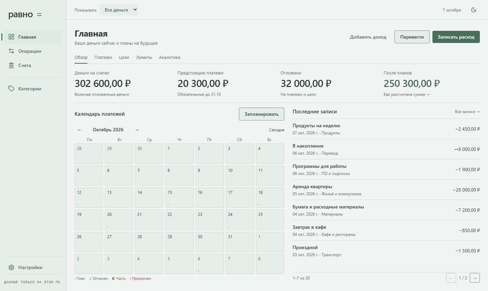
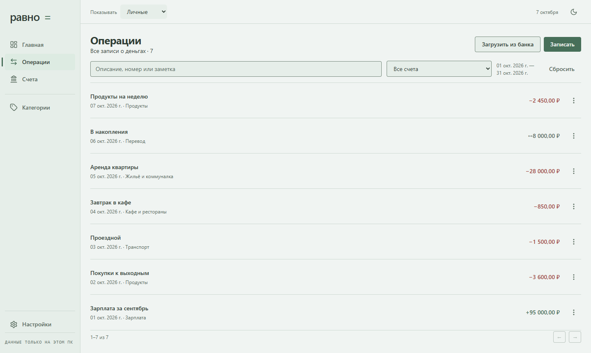
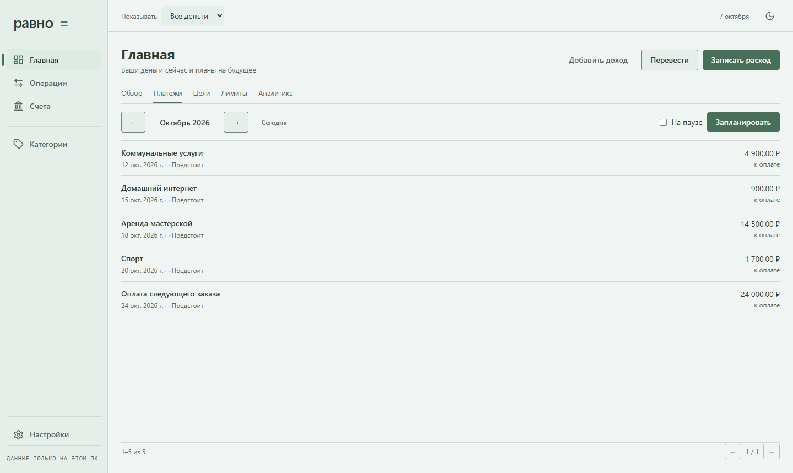

# Равно

**Личные и рабочие финансы — на вашем компьютере.**

Бесплатное приложение WebGoer для Windows. Доходы, расходы, счета и планы в одном месте: чтобы видеть остатки, следить за платежами и понимать, сколько денег остаётся после запланированных обязательств.

**[Скачать для Windows x64](https://github.com/Webgoer/ravno/releases/latest/download/Ravno-Setup-1.0.0-x64.exe)** · [Версия и изменения](https://github.com/Webgoer/ravno/releases/latest) · [Как установить](INSTALL.md)

Версия **1.0.0** · около **120 МБ** · русский интерфейс · без регистрации.

Установщик пока без цифровой подписи. Windows может показать предупреждение о неизвестном издателе; на некоторых компьютерах настройки защиты могут заблокировать запуск. Не отключайте системную защиту ради установки.

*Настоящий интерфейс приложения. Данные на изображениях демонстрационные.*

## Что умеет «Равно»

- Вести доходы, расходы и переводы между счетами.
- Разделять личный и рабочий учёт.
- Показывать остатки и будущие обязательства.
- Планировать платежи, бюджеты, резервы и накопления на цели.
- Импортировать CSV UTF-8, OFX и QFX с предварительным просмотром.
- Создавать локальные резервные копии и восстанавливать данные.
- Работать без обязательного подключения к интернету и без аккаунта.

Посмотреть операции и платежи

## Установка и данные

Скачайте EXE по кнопке выше, запустите его и пройдите шаги установки. Затем откройте «Равно» через ярлык на рабочем столе или в меню «Пуск». Для установки нужен компьютер с Windows x64; проверка этого выпуска выполнена в Windows 11.

Финансовые данные хранятся локально на вашем компьютере. Перед переносом приложения на другой ПК создайте резервную копию. Обычное удаление программы сохраняет пользовательские данные; повторная установка позволяет продолжить работу.

## Обратная связь

О проблеме можно сообщить в [Issues](https://github.com/Webgoer/ravno/issues): укажите версию Windows, версию приложения и действия, после которых появилась ошибка. Не прикладывайте личную базу финансов и банковские выписки.

Этот репозиторий содержит готовые выпуски и материалы приложения. Исходники приложения здесь не размещаются. Сведения о лицензиях сторонних компонентов входят в поставку приложения.
